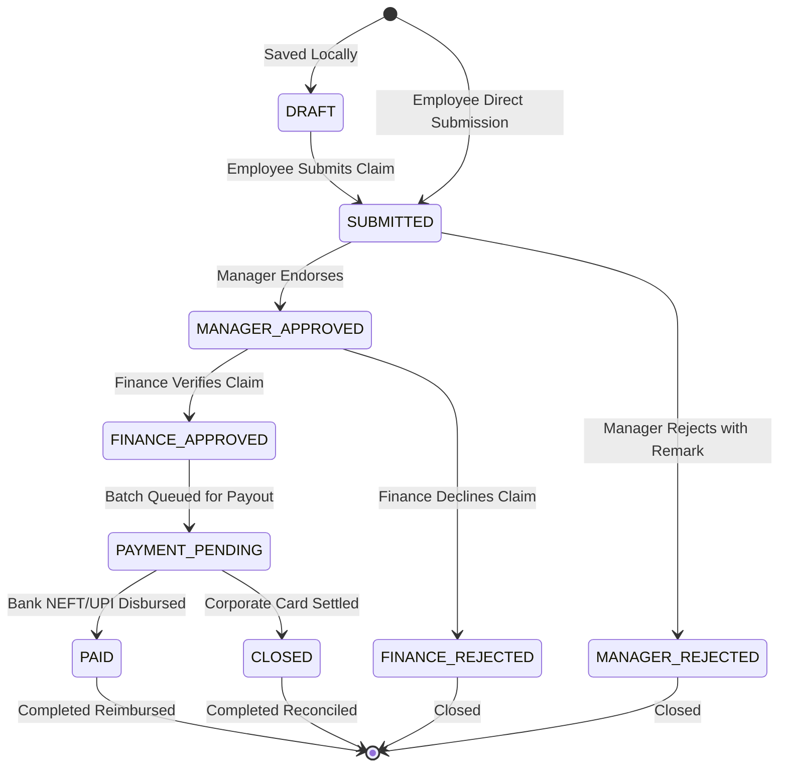

# FinPulse — Complete Application Workflow & Testing Guide

## 1. Overview & Architecture

FinPulse is an institutional-grade enterprise Expense & Treasury Management Platform designed for multi-tier corporate spend control. The system coordinates financial workflows across three primary organizational personas:

```
┌─────────────────┐       Submit Claim        ┌──────────────────┐
│    EMPLOYEE     │ ────────────────────────> │     MANAGER      │
│  (/employee)    │                           │    (/manager)    │
└─────────────────┘                           └─────────┬────────┘
         ▲                                              │
         │ Reimbursed / Settled                         │ Endorse Claim
         │                                              ▼
┌─────────────────┴┐       Disburse Payment   ┌──────────────────┐
│   SUPABASE DB    │ <─────────────────────── │  FINANCE ADMIN   │
│ (expense_claims) │                          │    (/finance)    │
└──────────────────┘                          └──────────────────┘
```

### Technology Stack
* **Frontend**: Next.js 16 (App Router, Turbopack, Tailwind CSS, Lucide icons, Dark/Light mode theme system)
* **Backend Database**: Supabase Cloud (PostgreSQL 15, Row Level Security, Storage bucket `receipts`)
* **Optional API**: FastAPI Python Backend (`/api/employee`, `/api/manager`, `/api/finance`) with automatic fallback to direct real Supabase Cloud client.
* **Production Deployment**: Vercel Production (`https://frontend-six-omega-8cs3dcwpjd.vercel.app`)

---

## 2. Complete Expense Lifecycle & State Machine

Every expense claim follows a strictly governed lifecycle:



### Status Reference Table

| Database Status | Normalized Status | Meaning | Actionable Portal |
|---|---|---|---|
| `DRAFT` | Draft | Saved locally, not yet sent to manager | Employee (`/employee`) |
| `SUBMITTED` | Pending | Submitted by employee; waiting for manager review | Manager (`/manager/approvals`) |
| `MANAGER_APPROVED` | Approved (Manager) / Pending (Finance) | Manager verified; queued for Finance verification | Finance (`/finance`) |
| `MANAGER_REJECTED` | Rejected | Manager rejected with feedback remark | Employee (`/employee`) |
| `FINANCE_APPROVED` | Approved | Finance verified; ready for disbursement | Finance (`/finance`) |
| `FINANCE_REJECTED` | Rejected | Finance declined policy or receipt | Employee (`/employee`) |
| `PAYMENT_PENDING` | Approved (Payment) | Processing bank payout / payment batch | Finance (`/finance`) |
| `PAID` / `DISBURSED` | Reimbursed | Out-of-pocket money transferred to employee account | Employee (`/employee`) |
| `CLOSED` / `SETTLED` | Reimbursed / Settled | Corporate card transaction reconciled | Employee (`/employee`) |

---

## 3. Role-by-Role Workflow Details

### A. Employee Portal (`/employee`)
1. **Summary Cards**:
   * **Ready for Reimbursement**: Total approved out-of-pocket claims ready to be paid to the employee.
   * **Pending Approval**: Total amount currently in review (`SUBMITTED` or `MANAGER_APPROVED`).
   * **Card Spending (MTD)**: Total corporate card expenses this month against the assigned monthly limit.
   * **Card Limit Remaining**: Remaining card allowance (`Limit - Spent`).
2. **Expense Table & Status Tabs**:
   * **All Expenses**: Complete ledger of employee's own claims.
   * **Pending**: Claims awaiting review.
   * **Approved**: Claims approved by manager/finance ready for payout.
   * **Reimbursed**: Settled corporate card or disbursed personal expenses.
   * **Drafts**: Locally saved drafts.
3. **New Expense Submission (`/employee/expenses/new`)**:
   * Captures merchant, amount, category (`TRAVEL`, `MEALS`, `SOFTWARE`, etc.), expense date, report, and payment method (`Corporate Card` vs `Personal Out-of-Pocket`).
   * Optional receipt invoice upload (saved to Supabase Storage `receipts` bucket).
   * Generates a new claim with status `SUBMITTED` and inserts it directly into `expense_claims`.

---

### B. Manager Portal (`/manager` & `/manager/approvals`)
1. **Cockpit View (`/manager`)**:
   * Overview of Department Budget utilization (Engineering, Product, Sales, Marketing).
   * Policy compliance tracking & team spend metrics.
2. **Approvals Console (`/manager/approvals`)**:
   * Displays all claims from department employees.
   * Filterable by status: **All**, **Pending**, **Approved**, **Rejected**.
   * Real-time search by employee name, claim ID, department, or description.
   * Click **Inspect** to see receipt image, policy notes, and transaction metadata.
3. **Actions**:
   * **Approve**: Changes status to `MANAGER_APPROVED`, records `manager_remark`, and syncs instantly to Supabase. Claim immediately enters the Finance review queue.
   * **Reject**: Prompts for feedback reason and updates status to `MANAGER_REJECTED`.

---

### C. Finance Admin Portal (`/finance`)
1. **Finance Overview**:
   * Cash disbursement metrics, pending approvals queue, policy exception breakdown.
2. **Verification & Audit Queue**:
   * Displays claims that have passed Manager Approval (`status = 'MANAGER_APPROVED'`).
   * Finance officer inspects GST tax invoices and policy limits.
3. **Disbursement & Payment Execution**:
   * **Approve**: Marks status as `FINANCE_APPROVED`.
   * **Disburse / Pay**: Triggers payout batch $\rightarrow$ sets status to `PAID` / `DISBURSED` with timestamp and transaction reference.

---

## 4. How to Test the Entire Workflow End-to-End

Follow these exact steps to test the real live database workflow:

### Step 1: Open Manager Approvals
1. Open the Manager Approvals page in your browser:
   * **URL**: `https://frontend-six-omega-8cs3dcwpjd.vercel.app/manager/approvals`
   * *(Or locally: `http://localhost:3000/manager/approvals`)*
2. In the status filter, select **"Pending"**.
3. You will see the active pending claims waiting for approval:
   * **`CLM-9011`**: *Ahammed Rabil* — `Client Onsite Architecture Sync` (₹16,500.00 | Travel | Personal Card)
   * **`CLM-9012`**: *Abhay* — `AWS Production Kubernetes Nodes` (₹24,800.00 | Software | Corporate Card)

### Step 2: Test Manager Approval
1. On claim `CLM-9011` (*Ahammed Rabil*), click the green **"Approve"** button (or click the row to Inspect and click Approve).
2. A toast notification will confirm: `Approved claim CLM-9011 for Ahammed Rabil (₹16,500)`.
3. In the UI, the claim immediately transitions to **"Approved"** status and updates the KPI counters.
4. In Supabase PostgreSQL, `expense_claims.status` is updated to `'MANAGER_APPROVED'`.

### Step 3: Test Manager Rejection
1. On claim `CLM-9012` (*Abhay*), click the red **"Reject"** button.
2. A toast will confirm: `Rejected claim CLM-9012 for Abhay`.
3. In Supabase PostgreSQL, `expense_claims.status` is updated to `'MANAGER_REJECTED'`.

### Step 4: Verify in Employee Dashboard
1. Open Employee Dashboard: `https://frontend-six-omega-8cs3dcwpjd.vercel.app/employee`
2. Notice how the pending count and amounts update live from the database.
3. When logged in as *Ahammed Rabil*, `CLM-9011` is now recognized as Manager Approved and ready for finance reimbursement.

### Step 5: Test Submitting a New Claim as Employee
1. Go to `https://frontend-six-omega-8cs3dcwpjd.vercel.app/employee/expenses/new`
2. Fill in:
   * **Merchant**: `Uber Business India`
   * **Amount**: `1250`
   * **Category**: `Travel`
   * **Payment Method**: `Personal (Out-of-Pocket)`
   * **Purpose**: `Client meeting transfer`
3. Click **"Submit Expense"**.
4. Return to `/manager/approvals`: your newly submitted claim will immediately show under **"Pending"** waiting for the manager's endorsement!

---

## 5. Verified Test Accounts & Roles

All accounts are pre-configured in Supabase `profiles` with active RLS permissions:

| Email | Role | Department | Default Portal |
|---|---|---|---|
| `karanmanager@gmail.com` | `MANAGER` | Engineering | `/manager` & `/manager/approvals` |
| `sowmi@gmail.com` | `MANAGER` | Engineering | `/manager` & `/manager/approvals` |
| `sow@gmail.com` | `FINANCE` | Engineering | `/finance` |
| `adityadevlops@gmail.com` | `ADMIN` | Engineering | `/admin` & all dashboards |
| `ahammedrabil@gmail.com` | `EMPLOYEE` | Engineering | `/employee` |
| `abhay@gmail.com` | `EMPLOYEE` | Engineering | `/employee` |
| `teju@gmail.com` | `EMPLOYEE` | Engineering | `/employee` |
| `teja@gmail.com` | `EMPLOYEE` | Engineering | `/employee` |

---

## 6. Key Supabase Tables Reference

* **`expense_claims`**: Master ledger containing all employee expense submissions, statuses, receipts, and remarks.
* **`profiles`**: User directory with assigned organizational role (`EMPLOYEE`, `MANAGER`, `FINANCE`, `ADMIN`) and department.
* **`department_budgets`**: Departmental spending caps, allocated amounts, and threshold monitoring.
* **`expense_policies`**: Spending limits per category (`HOTEL`, `MEALS`, `TRAVEL`, etc.) and receipt threshold rules.
* **`employee_cards`**: Corporate cards issued to employees with monthly limits and active status.
* **`storage.buckets ('receipts')`**: Storage for uploaded PDF tax invoices and JPG/PNG receipt vouchers.
